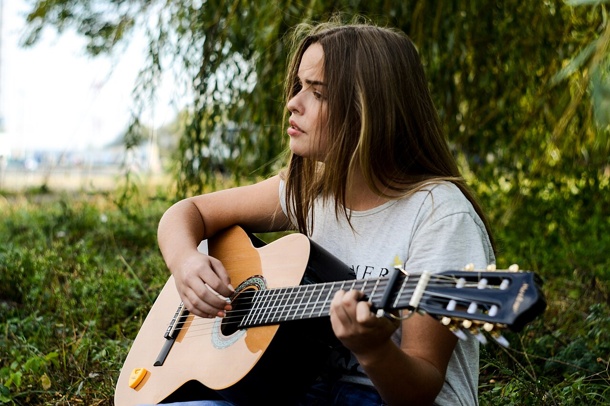
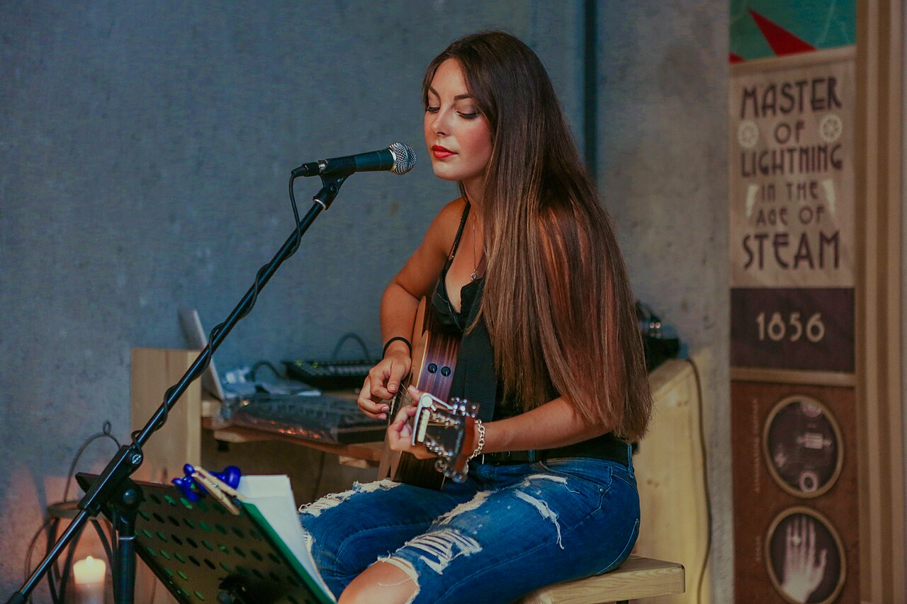

# Разбор 07: удержание гитары, голова и шея по реальным фотографиям

17 октября 2026 года. Прямое уточнение пользователя: взять референсы из интернета и отдельно посмотреть положение головы/шеи. Здесь сохранён разбор; игровая поза этим документом не исправлена.

## Главный вывод

Предыдущие итерации улучшили инструмент, сетку и веса, но сохранили неудачную основу позы. Алина выглядит напряжённой, с обособленно поставленной головой и неубедительной связью инструмента с телом. Следующий приоритет — заново согласовать всю посадку с гитарой, плечами, шеей и головой. Еду и косметическую доводку кожи отложить до убедительного образца этой позы.

## Что действительно просмотрено

Повторно просмотрена предоставленная пользователем фотография гитариста на скамье. С Commons загружены и просмотрены восемь фотографий; одна с фламенко отброшена как неподходящая. Уточнены ограничения остальных: два снимка одного исполнителя не считаются разными людьми; электрогитара не задаёт опору акустики, шарф/волосы могут скрывать шею, обрезанный кадр не подтверждает опору бедра. Видео на этом шаге не изучалось; из статичных фото не выводится полный цикл движений.

Два наиболее подходящих новых кадра:

- [Outdoor acoustic guitar performance](https://commons.wikimedia.org/wiki/File:Outdoor_acoustic_guitar_performance_(Unsplash).jpg), Mariana Vusiatytska, CC0: взаимное положение корпуса инструмента, правого предплечья и плеч; голова естественно повёрнута в сторону.
- [Woman with acoustic guitar](https://commons.wikimedia.org/wiki/File:Woman_with_acoustic_guitar_(Unsplash).jpg), Nick Karvounis, CC0: сидение в три четверти сбоку, мягкая линия корпуса/плеч, голова немного наклонена; человек поёт, поэтому точное положение относительно микрофона не копируется.

Для открытой линии шея–плечи отдельно просмотрен [The Great Escape 2007 — Kaki King](https://commons.wikimedia.org/wiki/File:The_Great_Escape_2007-_Kaki_King.jpg), CC BY-SA 3.0. Верх корпуса и наклон головы хорошо видны; гитара и ноги обрезаны. Авторство, ссылки, лицензии, SHA и назначение всех фотографий — `evidence/posture-07/references.json`. Только два CC0-файла выше включены в документацию, без изменений; в игру фотографии не добавлены.

## Сравнение с текущей Алиной

| Область | Наблюдение в референсах | Что неубедительно у Алины | Что проверять при исправлении |
|---|---|---|---|
| Опора инструмента | Видима связь гитары с туловищем, бедром и правой рукой; варианты высоты/угла различаются | Инструмент выглядит отдельно выставленным перед телом, опора читается слабо | Сначала выбрать понятные контакты с бедром/туловищем и опору предплечья; затем положение грифа |
| Корпус и таз | Есть баланс сидящего человека; плечи приспосабливаются к инструменту | Верх тела слишком жёсткий, руки выглядят подведёнными к неподвижной гитаре | Таз, грудная клетка, плечи и гитара должны формировать одну согласованную позу |
| Левая рука | Положение локтя/запястья следует за грифом, пальцы имеют анатомически правдоподобные дуги | Напряжённый залом запястья и пальцы, похожие на отдельно подогнанные крючки | Подвод предплечья и положение ладони; ограничения суставов, затем аккорд |
| Правая рука | Предплечье связано с верхней частью корпуса гитары, кисть продолжает его в рабочую зону | Опора и расслабленность руки выражены недостаточно; техническая достижимость не решает постановку | Опора предплечья, свободное плечо, линия запястья и выбранный способ игры |
| Шея и голова | Положение головы согласовано с плечевым поясом и задачей взгляда; встречаются прямое положение, поворот и наклон | В кадрах шея воспринимается вытянутой и жёсткой, голова — высоко и обособленно поставленной | Проверить общую длину/толщину и посадку головы в нейтральном профиле, переходы к челюсти/ключицам, затем позу |
| Взгляд | Исполнители могут смотреть на струны, в сторону или вперёд; постоянный взгляд вниз не обязателен | В образце взгляд преимущественно направлен перед собой и слабо связан с руками | Выбрать осмысленную цель взгляда, распределять поворот/наклон между верхом корпуса, шеей, головой и глазами |

Текущие кадры: [общий](evidence/body-06/world/seated-front.png), [сбоку](evidence/body-06/world/seated-side.png), [руки/шея в три четверти](evidence/body-06/world/guitar-hands.png). Видимые недостатки оцениваются по нескольким ракурсам; один скриншот не доказывает отсутствие любого контакта.

## Что объясняет код, а что пока является гипотезой

`human_skin.gd` задаёт гитаре положение и ориентацию относительно визуального корня. Руки решаются к точкам в координатах гитары; отдельной задачи контакта правого предплечья с обечайкой и поддержки инструмента бедром нет. `fit_finger` сохраняет длины фаланг, но не вводит анатомические пределы каждого сустава. Это позволяет получить достижимый, но неестественный хват.

В дополнительном управлении головой есть ограниченный yaw и добавочный наклон Head на 0,04 рад в сидении, поверх исходного клипа. При нулевой цели взгляда гриф не выбирается целью автоматически. Это не полный замер движения исходного клипа sit: его вклад отдельно не исследован на видео. Для исправления требуется согласованное управление всей верхней цепочкой, а не один постоянный наклон головы.

Геометрия шеи ранее локально сдвигалась вперёд внизу для совмещения с воротом. Этот стык необходимо повторно оценить вместе с плечами и положением головы. Утверждать, что единственная причина — лишние сантиметры длины шеи, пока нельзя. Сохранены выборки rest-геометрии и координаты костей; сечения неполные и могут захватывать челюсть, поэтому их центры нельзя считать анатомической осью или основанием для численного укорочения. Визуальный дефект определён; точный вклад геометрии, ретаргетинга и позы ещё разделяется.

## Порядок следующей переработки

1. Нейтральная фигура спереди/сбоку: пропорции головы, шеи, плеч и грудной клетки, плавность переходов. При необходимости заменить или пересобрать основу; прежний ресурс не является обязательством.
2. Согласованная посадка с тазом и ступнями на опоре. Определить положение и баланс акустики по реальным контактам с телом.
3. Плечи, локти и запястья поставить от этой посадки; затем сформировать естественные кисти/пальцы с ограничениями суставов.
4. Задать осмысленный взгляд, согласовать его с верхом корпуса, шеей и головой. Не фиксировать голову постоянно опущенной и не добавлять случайный наклон ради живости.
5. Сравнить силуэт и контакты спереди/сбоку/в три четверти при простом свете; затем проверить движение по видео и вернуть материалы локации. Численные тесты использовать как дополнительную проверку.

Игровые исходники, меши, правила и анимации этим шагом не изменены; тесты игры не повторялись. Проверенная игровая точка остаётся source `93a423e`, общий HEAD перед этим документом — `849bf4a`. Исследование, источники и уточнённый приоритет сохраняются отдельным коммитом и небольшим документальным ZIP.
